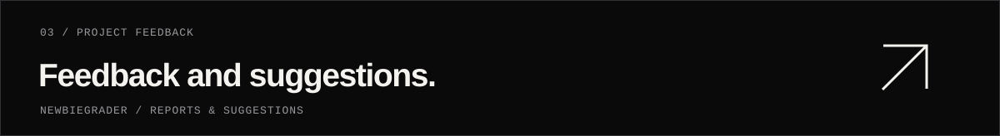

  <a href="https://github.com/n3wbiekkkk"><picture><source media="(max-width: 600px)" srcset="./assets/header-mobile.svg"></picture></a>

  <a href="#current-project"><strong>CURRENT PROJECT</strong></a> &nbsp; / &nbsp;
  <a href="#github-activity"><strong>ACTIVITY</strong></a> &nbsp; / &nbsp;
  <a href="https://github.com/n3wbiekkkk/Newbiegrader/issues"><strong>FEEDBACK ↗</strong></a>

 

I am **New**, a student with an interest in programming. I am currently working on **[Newbiegrader](https://github.com/n3wbiekkkk/Newbiegrader)**, an online judge for programming practice in Thai.

 

## Current project

<a href="https://newbiegrader.pages.dev"><picture><source media="(max-width: 600px)" srcset="./assets/judge-mobile.svg"></picture></a>

  <a href="https://newbiegrader.pages.dev"><strong>VIEW PLATFORM ↗</strong></a> &nbsp; / &nbsp;
  <a href="https://github.com/n3wbiekkkk/Newbiegrader"><strong>SOURCE CODE</strong></a> &nbsp; / &nbsp;
  <a href="https://github.com/n3wbiekkkk/Newbiegrader/tree/main/docs"><strong>DOCUMENTATION</strong></a>

 

## GitHub activity

<a href="https://github.com/n3wbiekkkk?tab=overview"><picture><source media="(max-width: 600px)" srcset="./assets/activity-mobile.svg"></picture></a>

  
View contribution history

   
  

 

<a href="https://github.com/n3wbiekkkk/Newbiegrader/issues"><picture><source media="(max-width: 600px)" srcset="./assets/footer-mobile.svg"></picture></a>
