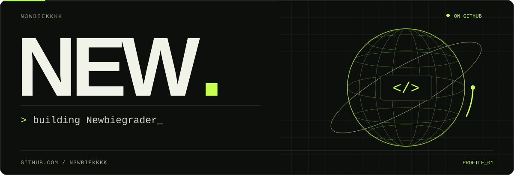
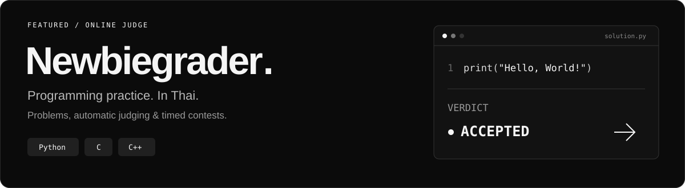
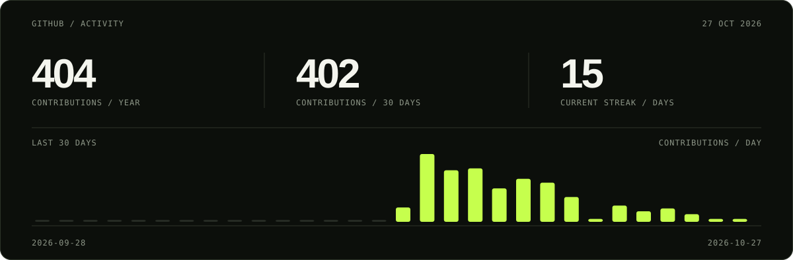

  
  

I'm **New**. Currently working on **[Newbiegrader](https://github.com/n3wbiekkkk/Newbiegrader)**, a programming judge in Thai.

### `01` &nbsp; PROJECT

  <a href="https://newbiegrader.pages.dev">Try it ↗</a> &nbsp; / &nbsp;
  <a href="https://github.com/n3wbiekkkk/Newbiegrader">Repository</a> &nbsp; / &nbsp;
  <a href="https://github.com/n3wbiekkkk/Newbiegrader/tree/main/docs">Docs</a>

### `02` &nbsp; ACTIVITY

### `03` &nbsp; SNAKE

  

n3wbiekkkk &nbsp; / &nbsp; EOF

